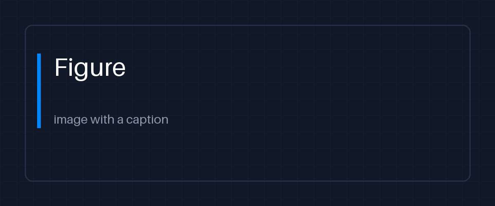

This draft shows every element the blog supports. It stays a draft, so it is not in the lists or the sitemap. Build it locally with `python3 tools/blog.py build --number 1`.

## Text

A paragraph has *emphasis*, **strong text**, ~~strikethrough~~ and `inline code`. An external link such as [the Python documentation](https://docs.python.org/3/) opens in a new tab. A link to another article uses the relative path of the built article, for example [the next one](../0002-next-article/). A footnote sits right here.[^first]

### A third-level heading

Every heading has an anchor link to its section. Hover over it or tap it on a phone.

#### A fourth-level heading

Level 4 is the deepest level.

## Lists

Unordered, with nesting:

- First item
- Second item
    - Nested item
    - Another nested item
        - A third level
- Third item

Ordered:

1. Write the draft
2. Build it locally
3. Publish it

## Image with a caption

An image with a title renders as a figure, and the title is the caption.



An image without a title renders as a figure without a caption.


## Code

A fenced block with a language tag has build-time syntax highlighting, a language label and a copy button.

```python
from dataclasses import dataclass


@dataclass
class Article:
    number: int
    slug: str

    def key(self) -> str:
        return f"{self.number:04d}-{self.slug}"  # 0001-blog-features-demo


print(Article(1, "blog-features-demo").key())
```

A block without a language tag stays plain:

```
plain text, no highlighting
second line
```

## Code tabs

Adjacent fenced blocks with different language tags render as one block with a tab per language. The chosen language is remembered across the site, so every tabbed block shows it.

```python
import json

with open("data.json") as f:
    data = json.load(f)
print(len(data))
```

```javascript
const fs = require("node:fs");

const data = JSON.parse(fs.readFileSync("data.json", "utf8"));
console.log(data.length);
```

```bash
jq length data.json
```

A second tabbed block follows. Choosing a language in the first block switches this one too.

```python
print("hello")
```

```javascript
console.log("hello");
```

## Audio

A fenced `audio` element with `ru` and `en` source URLs renders as one player with a tab per language. The default tab is the language of the page. An optional `caption` is shown under the player.

```audio
ru: v1_ru.ogg
en: v1_en.ogg
caption: A short caption under the player.
```

A second player can use absolute URLs, which the build leaves unchanged.

```audio
ru: https://example.com/ru.ogg
en: https://example.com/en.ogg
```

## Table

A table scrolls horizontally on narrow screens and keeps the column alignment.

| Command | Left aligned | Centered | Right aligned | What it does in a long sentence that forces a wide column |
|:--------|:-------------|:--------:|--------------:|:-----------------------------------------------------------|
| `start` | text | text | 1 | Creates the source folder of a new article with both languages and platform drafts |
| `build` | text | text | 22 | Renders both languages, the lists, the tag pages and the sitemap |
| `publish` | text | text | 333 | Sets the status to published and builds the pages |

## Quote

> A block quote keeps its own look.
>
> It can have several paragraphs.

## Section break

Text before the break.

---

Text after the break.

## Notes

Footnotes render at the end of the body with numbers and back-links.[^second] They can carry formatting and links too.

[^first]: The first footnote, with a link back to the text.
[^second]: The second footnote has *emphasis* and [a link](https://example.com/).
