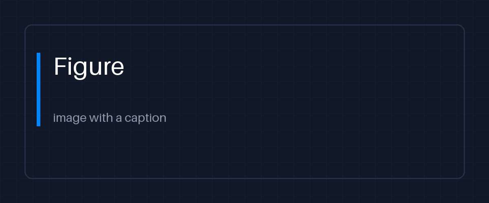

Этот черновик показывает все элементы, которые поддерживает блог. Он остаётся черновиком, поэтому его нет в списках и в карте сайта. Локально его можно собрать командой `python3 tools/blog.py build --number 1`.

## Текст

В абзаце есть *курсив*, **жирный текст**, ~~зачёркнутый текст~~ и `код в строке`. Внешняя ссылка, например [документация Python](https://docs.python.org/3/), открывается в новой вкладке. Ссылка на другую статью использует относительный путь собранной статьи, например [следующая статья](../0002-next-article/). Здесь стоит сноска.[^first]

### Заголовок третьего уровня

У каждого заголовка есть якорная ссылка на раздел. Наведите на неё курсор или нажмите на телефоне.

#### Заголовок четвёртого уровня

Четвёртый уровень самый глубокий.

## Списки

Маркированный, с вложенностью:

- Первый пункт
- Второй пункт
    - Вложенный пункт
    - Ещё один вложенный пункт
        - Третий уровень
- Третий пункт

Нумерованный:

1. Написать черновик
2. Собрать его локально
3. Опубликовать

## Картинка с подписью

Картинка с title отрисовывается как figure, а title становится подписью.



Картинка без title отрисовывается как figure без подписи.


## Код

Блок кода с тегом языка подсвечивается при сборке, у него есть метка языка и кнопка копирования.

```python
from dataclasses import dataclass


@dataclass
class Article:
    number: int
    slug: str

    def key(self) -> str:
        return f"{self.number:04d}-{self.slug}"  # 0001-blog-features-demo


print(Article(1, "blog-features-demo").key())
```

Блок без тега языка остаётся простым:

```
простой текст, без подсветки
вторая строка
```

## Вкладки кода

Подряд идущие блоки кода с разными тегами языка отрисовываются как один блок с вкладкой на каждый язык. Выбранный язык запоминается на всём сайте, поэтому каждый блок с вкладками его показывает.

```python
import json

with open("data.json") as f:
    data = json.load(f)
print(len(data))
```

```javascript
const fs = require("node:fs");

const data = JSON.parse(fs.readFileSync("data.json", "utf8"));
console.log(data.length);
```

```bash
jq length data.json
```

Дальше второй блок с вкладками. Выбор языка в первом блоке переключает и этот.

```python
print("привет")
```

```javascript
console.log("привет");
```

## Таблица

Таблица прокручивается по горизонтали на узких экранах и сохраняет выравнивание колонок.

| Команда | По левому краю | По центру | По правому краю | Что она делает, в длинном предложении, которое растягивает колонку |
|:--------|:---------------|:---------:|----------------:|:--------------------------------------------------------------------|
| `start` | текст | текст | 1 | Создаёт папку исходников новой статьи с двумя языками и черновиками для платформ |
| `build` | текст | текст | 22 | Собирает оба языка, списки, страницы тегов и карту сайта |
| `publish` | текст | текст | 333 | Ставит статус published и собирает страницы |

## Цитата

> Цитата сохраняет свой вид.
>
> В ней может быть несколько абзацев.

## Разделитель

Текст до разделителя.

---

Текст после разделителя.

## Заметки

Сноски отрисовываются в конце текста с номерами и обратными ссылками.[^second] В них тоже можно использовать оформление и ссылки.

[^first]: Первая сноска, со ссылкой обратно в текст.
[^second]: Во второй сноске есть *курсив* и [ссылка](https://example.com/).
